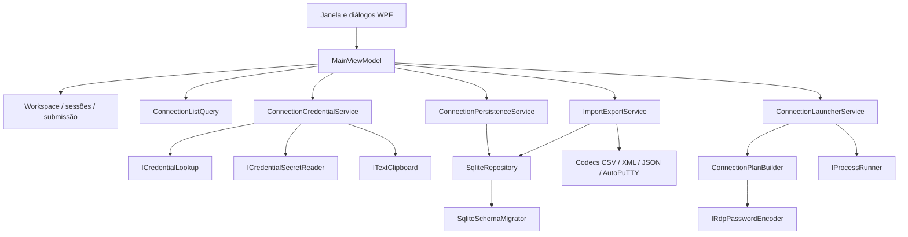

# Arquitetura do ConectaTI 1.8.1

Atualizada em 05/11/2026. Evoluída sobre a entrega 1.8.0, a refatoração estrutural da 1.7.0 e a referência funcional da 1.6.0. A aplicação continua em C#/.NET 10 Windows, WPF/MVVM e SQLite portátil, com as mesmas dependências e publicada em **um único executável (`ConectaTI.exe`)**.

## Mapa de responsabilidades

| Componente | Responsabilidade e limite |
| --- | --- |
| `MainWindow` e diálogos | Controles, barra superior adaptativa (`TopOverflowButton`), botões **Tema** e **Configurações** (engrenagem vetorial de 8 dentes com círculo central), aba lateral direita e painel recolhível **Textos rápidos** (`QuickTextsEdgeTabButton` / `QuickTextsSidePanel`), limites dinâmicos da divisória lado a lado (`MainPanelsSplitter` com alça discreta), foco por teclado, eventos contextuais (`Esc`/`F1`/`F2`/`Ctrl+,`) e apresentação no Dispatcher. |
| `ThemeService` / `ViewPreferencesService` | Centralização dos pincéis semânticos dos temas Claro/Escuro (incluindo barra de rolagem fina, cinza e arredondada com trilho discreto e maior contraste ao passar o mouse) e cálculo independente de tamanho de fonte (11–18) e densidade (`Compacto`/`Confortável`). |
| `KeyboardShortcutsCatalog` | Catálogo centralizado e localizado dos atalhos implementados na aplicação, consumido pela aba **Atalhos** das Configurações e pelos testes. |
| `MainViewModel` | Fachada dos bindings/comandos existentes, notificações, ícones/textos de estado da senha, publicação das listas e coordenação do editor. Não contém DDL, regras de ordenação nem a reconciliação interna de um save. |
| `ConnectionEditWorkspace` | Sessões por ID estável, sessão corrente, geração de ativação e novos rascunhos em memória. Não grava banco nem conhece controles. |
| `ConnectionEditSession` / `ConnectionSaveSubmission` | Baseline, intenção de senha, revisões e submissão independente; reconcilia o commit preservando campos e senha editados depois da submissão. |
| `EditorOperationGuard` | Captura identidade do objeto, IDs, geração e revisões; descarta a conclusão de uma operação que já pertence a outro estado do editor. Compartilhado por comandos, diálogo de credenciais e diagnóstico. |
| `PasswordRevealLease` | Ordenação dos pedidos de revelação e prazo/cancelamento da apresentação. Não guarda senha nem objetos WPF. O chamador aplica a apresentação no Dispatcher. |
| `ConnectionListQuery` | Filtros (incluindo `ConnectionActivityFilter`: `Todos` / `Ativos` / `Inativos`), busca sem acentos, ordenação, escolha por ID na ordem exibida e cálculo limitado do movimento. Não altera coleções vinculadas. |
| `ConnectionListNavigation` | Adaptador WPF da ordem exibida para seleção, containers virtualizados e foco. Mantém o consumo único das setas em PreviewKeyDown na janela e sincroniza rolagem/seleção após mudanças de filtro (`SyncListSelectionAndScroll`). |
| `HotKeyTextService` / `QuickTextsPopupWindow` | Módulo interno integrado no próprio processo `ConectaTI.exe` (baseado no `HotKeyText` v1.3.0, `viniciusdaveigaa/HotKeyText@7b5791b39e59c96a4203ed3a71ad7e73f8f125ac`, por Vinícius da Veiga). Gerencia `%APPDATA%\HotKeyText\textos.xml` (incluindo `OcultarTexto`), hook global `WH_KEYBOARD_LL` (`Scroll Lock`), popup rápido, rastreamento da última janela externa de destino (`LastExternalTargetWindow`), modos `Digitar` e `Colar` (local e WTS/RDP) e detecção de conflito com edição avulsa (`DetectStandaloneConflict`). |
| `AppUpdateService` | Consulta da última Release estável em `MaxBSilva/ConectaTI`, validação de autenticidade e integridade (SHA-256, cabeçalho PE e manifesto do executável único `ConectaTI.exe`), migração automática a partir de instalações de dois executáveis (removendo o `HotKeyText.exe` legado da raiz após backup), aviso de rascunhos pendentes, ponto de recuperação (`update-rollback/previous-install`) e reversão transacional automática em caso de falha. |
| `ConnectionCredentialService` | Consulta e leitura com validação de atualidade/cancelamento antes e depois dos awaits; cópia explícita pela fronteira do clipboard. Sem dependência de controles, SQLite ou implementação DPAPI. |
| `CredentialVaultService` / `ClipboardService` | Adaptadores existentes para proteção/recuperação de segredos e clipboard Windows com retry/limpeza por hash. O armazenamento e seus formatos não foram substituídos. |
| `ConnectionPersistenceService` / `SqliteRepository` | Commit de cadastro/credencial e CRUD, importação transacional, backups e recuperação. O repositório delega a evolução de esquema. |
| `SqliteSchemaMigrator` | Migrações 1–10, ledger, backup prévio e transações, preservando SQL e ordem histórica. `DatabaseMigrationManager` continua cuidando da descoberta de bases legadas. |
| `ImportExportService` | Detecção, prévia, duplicatas, erros, transporte protegido e coordenação do commit. |
| `ConnectionCsvCodec` / `CsvRecordCodec` | Mapeamento dos campos e sintaxe CSV com escape, limites e progresso/cancelamento existentes. |
| `ConnectionXmlCodec` / `ConnectionJsonCodec` | Formatos próprios e compatibilidade dos nomes/aliases. Sem acesso a banco ou cofre. `AutoPuttyCodec` permanece especializado no formato legado. |
| `ConnectionTransferValues` / `ImportModels` | Conversões compatíveis e contratos de intercâmbio, conservando namespace, nomes e valores serializados. |
| `ConnectionPlanBuilder` / `CommandLineTokenizer` | Conteúdo RDP, nomes de sessão e argumentos para os protocolos, sem iniciar processos nem consultar credenciais/banco. Resolução de executáveis continua no adaptador existente. |
| `ConnectionLauncherService` | Orquestra leitura, plano, provisionamento temporário RDP, arquivo protegido, execução e histórico de abertura. As proteções por host e ID de limpeza permanecem. |
| `NetworkDiagnosticService` | DNS/TCP e seus timeouts. Disponibilidade de porta não representa autenticação nem status manual do cadastro. |

## Fluxos e dependências

As interfaces foram introduzidas nas fronteiras efetivamente usadas por testes: `ICredentialLookup`, `ICredentialSecretReader`, `ITextClipboard`, `IProcessRunner`, `IRdpPasswordEncoder` e `INetworkConnectivityProbe`. As implementações Windows seguem em produção; substitutos controlados permitem ensaiar atraso, falha e cancelamento sem iniciar clientes ou acessar servidores.

Não foi criada uma camada genérica de serviços nem um projeto Core independente. As regras extraídas não usam controles WPF, mas ainda são compiladas no assembly `net10.0-windows` e utilizam o modelo observável/localização existentes. Separar projetos/plataformas poderá ser avaliado posteriormente com uma fronteira já exercitada.

## Contrato de edição e conclusão assíncrona

1. O editor conserva a identidade estável do cadastro. Navegar captura o formulário na sessão em memória e ativa outra geração; não chama persistência.
2. Salvar captura sessão, snapshot, senha/intenção e revisões antes do primeiro await. Validação e commit usam essa submissão.
3. O commit atualiza o baseline da sessão submetida. Se houve edição posterior, somente o vínculo de credencial e o timestamp submetidos são reconciliados; os campos posteriores permanecem. A intenção da senha posterior é recalculada contra o segredo efetivamente gravado.
4. A fachada WPF protege eventos com restauração em finally, desassina o editor substituído e publica bindings no Dispatcher. Uma gravação de A não recarrega o formulário de B.
5. Cópia/revelação/diagnóstico capturam `EditorOperationGuard`. Uma mudança de identidade, vínculo, geração ou revisão invalida a entrega do resultado e das mensagens. O clipboard revalida também antes de cada tentativa de escrita.
6. O cancelamento lógico descarta a entrega; não promete interromper uma operação nativa de criptografia já iniciada. A revelação tem sua própria sequência e timer cancelável, e o diagnóstico recebe CancellationToken real.

Uma recarga da lista tem geração de leitura e revisão dos dados próprias: pode atualizar os dados publicados após uma navegação, preservando a seleção mais recente. Isso é diferente de autorizar um resultado de senha/diagnóstico no editor atual. Save é uma operação explicitamente submetida e pode concluir no banco após a navegação, sem substituir edições posteriores.

## Compatibilidade e semântica

- Esquema SQLite **10**; nenhuma migração nova foi introduzida. Ledger, backup, credenciais compartilhadas e formatos de proteção permanecem.
- `IsActive` é classificação manual. `IsDeleted` representa lixeira. A lista e a consulta não excluem inativos; DNS/TCP não modifica esses campos.
- O nome legado `ActiveConnectionsCount` e o método `GetActiveCountAsync` continuam disponíveis por compatibilidade e sempre significaram registros com IsDeleted=0. O código novo usa nomes explícitos de “fora da lixeira”; os textos do diagnóstico foram esclarecidos. O alias novo não altera o JSON legado.
- Propriedades/ordinais de `ConnectionEntry` e `AppSettings`, campos CSV/XML/JSON, SshPreference legado, pacotes protegidos e backups foram preservados. A classificação de inativo não impede conexão manual.
- Construtores/métodos antigos de lançamento usados pela suíte permanecem como fachadas de compatibilidade; a composição de produção usa IProcessRunner e não depende de clipboard ao conectar.
- O gerador de nomes RDP continua usando nome/endereço legíveis em diretório único, porta sem duplicação e os mecanismos efetivamente suportados pelo cliente.

## Testes e manutenção

Referência da 1.6.0: 257 casos; versão 1.7.0: 287 casos. A entrega 1.8.0 contém **294 casos**, todos aprovados na execução final, cobrindo o catálogo de atalhos, a independência entre fonte e densidade, o tratamento contextual de `Escape` durante edição com busca ativa, a adaptação responsiva da barra superior, as 7 abas de Configurações, o filtro `Todos`/`Ativos`/`Inativos` combinado com pesquisa/visões/setas/rascunhos, a integração do `HotKeyText` v1.3.0 pelo código-fonte (incluindo coexistência com instalação avulsa e modos `Digitar`/`Colar` local e WTS/RDP) e o fluxo de atualização via GitHub (`MaxBSilva/ConectaTI`) com validação SHA-256 e reversão automática em falha. Evidências, comandos, comparativo visual e análise de próximas melhorias em [RELATORIO-EVOLUCAO-1.8.0.md](RELATORIO-EVOLUCAO-1.8.0.md).

Os testes WPF continuam em STA com uma Application compartilhada e Dispatcher ativo. Para a janela isolada: `dotnet run --project tools/ConectaTI.UiSmoke -c Release -- --refactor-checks --narrow --font=18 --dark`. Esse modo cria pasta temporária fictícia e substitui somente o clipboard da cópia de teste. A navegação usa `--navigation --navigation-checks`.

Não usar bases pessoais para validar. Nenhuma execução de launcher/probe substituído equivale à autenticação em servidor remoto.
